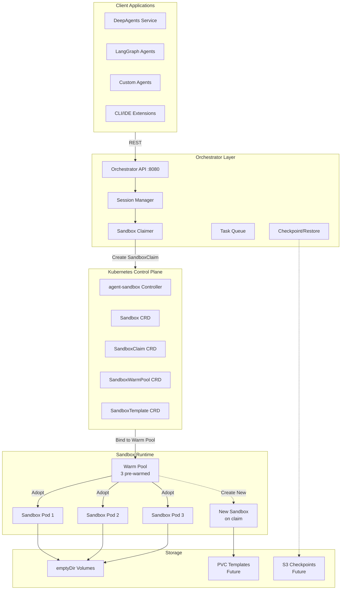
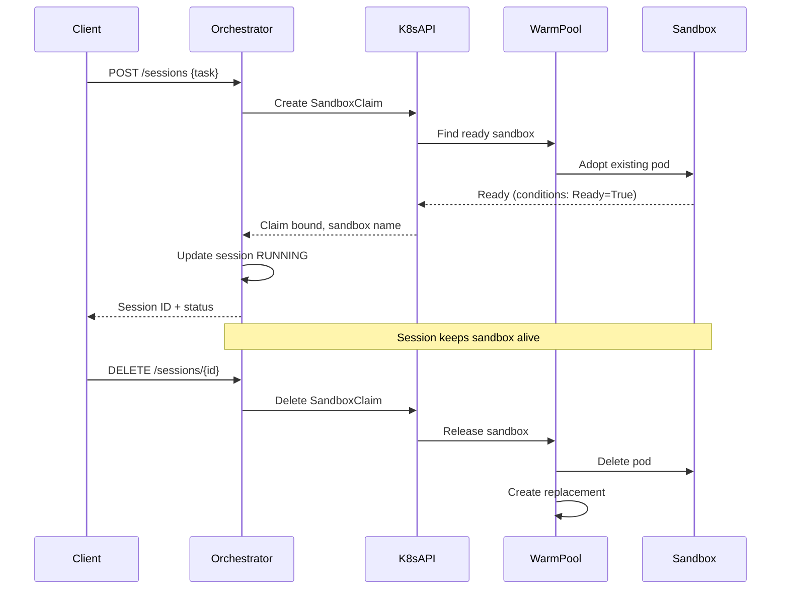
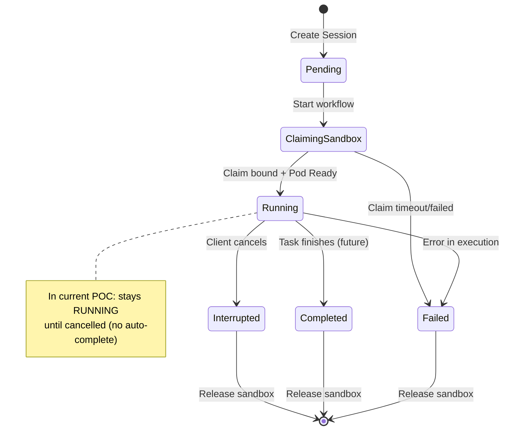
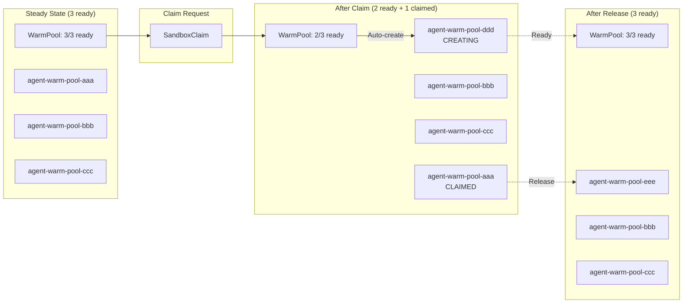
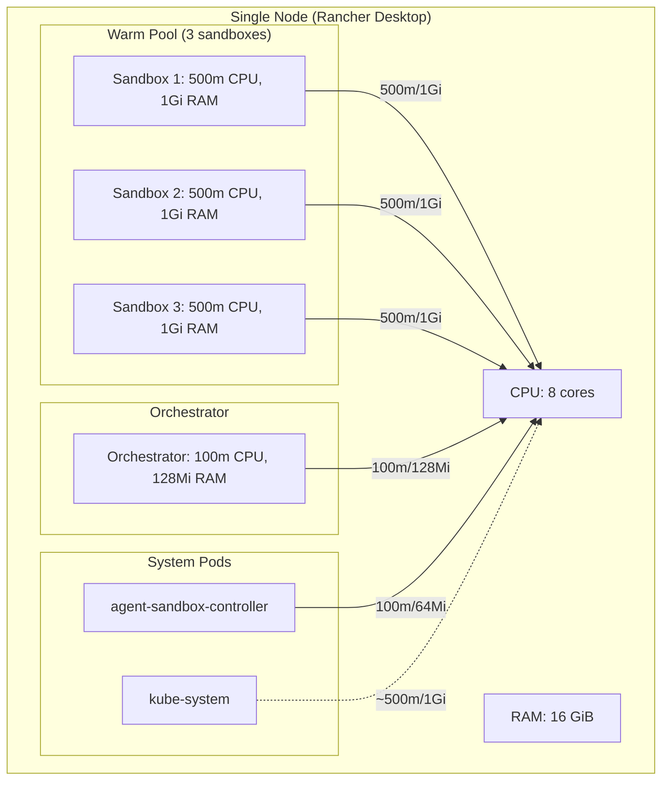
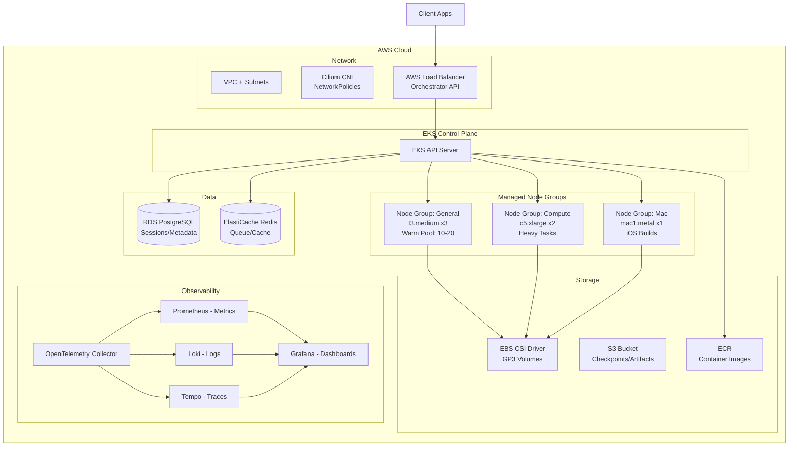
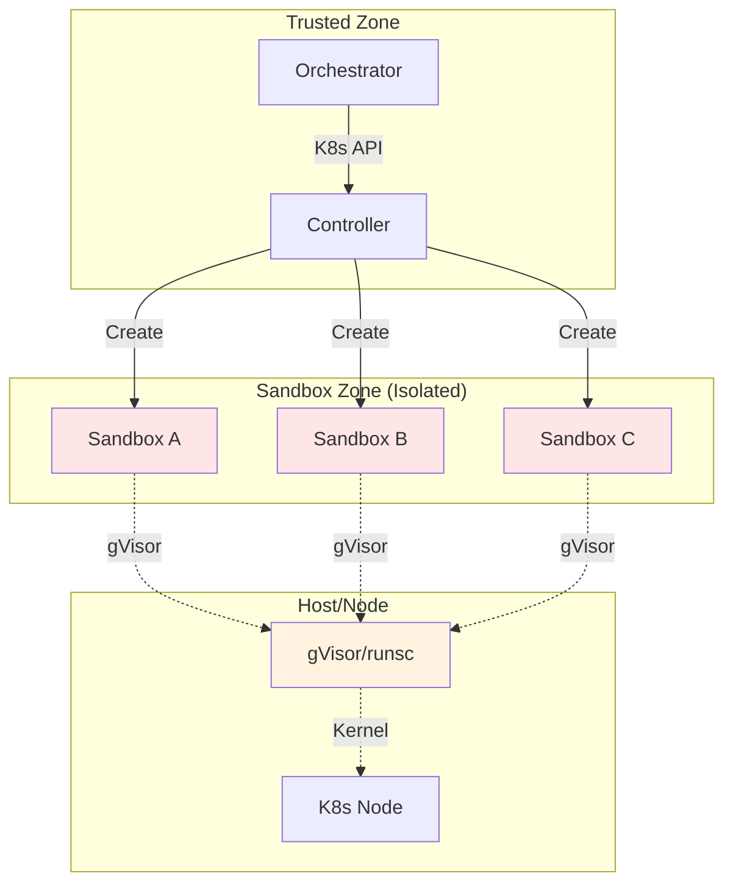

# Architecture Diagrams

## System Architecture (Mermaid)

## Sequence Diagram: Session Lifecycle

## Sandbox State Machine

## Warm Pool Replenishment

## Resource Requirements

## Production EKS Architecture

## Component Interaction Matrix

| From \ To | agent-sandbox Controller | Sandbox Pod | Warm Pool | Orchestrator | K8s API |
|-----------|-------------------------|-------------|-----------|--------------|---------|
| **Client** | - | - | - | REST API | - |
| **Orchestrator** | Watch/Create Claims | Exec (future) | Read Status | - | Full Access |
| **Controller** | - | Create/Manage | Reconcile | - | Full Access |
| **Warm Pool** | Create Sandboxes | Adopt Pods | - | - | - |
| **Sandbox Pod** | Report Status | - | - | Execute Tasks | - |

## Security Boundaries

